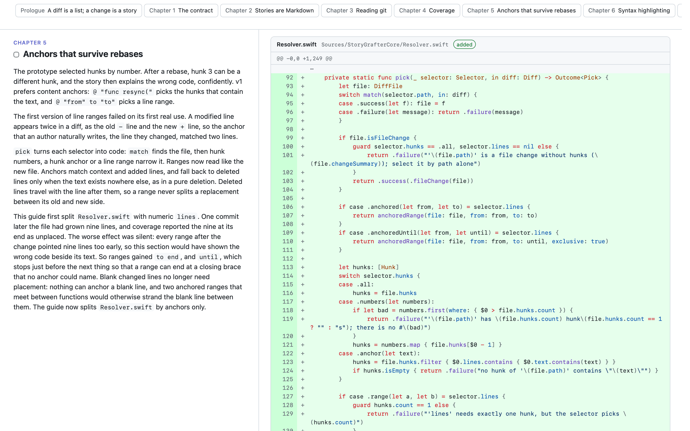

# StoryGrafter

A gardener grafts a scion onto a rootstock so that the two grow as one tree. StoryGrafter grafts the author's story onto a code change, line by line.

It builds a **review guide**: the story of a change in sections on the left, and next to each section the exact diff lines it explains. The output is one self-contained HTML file. The idea comes from Linear's review guides (https://linear.app/docs/diffs).

[](https://files.d.nevyn.dev/k/59b72839cae4e5e7/allonet2-46-guide.html)

[Open the full example guide](https://files.d.nevyn.dev/k/59b72839cae4e5e7/allonet2-46-guide.html) for [alloverse/allonet2#46](https://github.com/alloverse/allonet2/pull/46), a fix for a server beat that slowed down as its world grew. The story, [example/allonet2-46.md](example/allonet2-46.md), was reconstructed afterwards from the pull request and its commits rather than written in the authoring session. To rebuild it:

```sh
git clone https://github.com/alloverse/allonet2.git
storygrafter build --repo allonet2 --story example/allonet2-46.md --out allonet2-46.html
```

The build enforces **coverage**: every changed line of the diff is placed in exactly one section, so a reviewer who reads the story has seen the whole change.

## Let your agent write it

StoryGrafter is meant to be run by the coding agent that made the change, at the end of the session. The agent knows what the diff doesn't show: why the change exists, the evidence behind it, the approaches that failed, the edge cases it found. A review guide is where that knowledge lands, next to the code it explains. Writing the guide is also a review: explaining each section forces the agent to check its claims against the code, and that finds bugs.

Install it, then ask your agent:

```
Run `storygrafter prompt` and follow its instructions to write a review guide for this branch and publish it on the merge request we're working on.
```

`storygrafter prompt` prints this repository's context (branch, range, where the story goes, whether an upload command is configured) and then the instructions: how to tell the story, what to include from the conversation and what to keep out, how to check and build, and how to publish and keep the guide current. The instructions ship with the binary, so they always match the installed version.

To make it routine, add a rule like this to your agent's instructions file (`CLAUDE.md`, `AGENTS.md`):

```
## Review guides
- Build a review guide with `storygrafter` when a merge request leaves draft, and again after every push to it: run `storygrafter prompt` and follow it.
- Publish the HTML with <your forge's upload tool>, and link it from the description under a "Review guide" heading, replacing the previous link.
```

## Install

```sh
brew install nevyn/tap/storygrafter
```

## Usage

```sh
storygrafter prompt                # instructions for your agent, with this repository's context
storygrafter format                # the story format
storygrafter paths                 # where the story and the guide for this branch live
storygrafter list                  # the diff's hunks, and where the story places each one
storygrafter check                 # every coverage and selector problem, or ok
storygrafter build                 # write the guide and print its path
```

Stories live in `.storygrafter/<branch>.md` in the worktree, which git ignores through a `.gitignore` that storygrafter writes inside that directory, and the guide is written next to them. The range defaults to `<origin's default branch>...HEAD`; set `range:` in the story or pass `--range`. `storygrafter list --json` is for agents. The docs are listed in [docs/index.md](docs/index.md).

## Optional extras

- **Upload in one step.** Configure an upload command that publishes a file and prints its URL, and `storygrafter build --upload` prints a link to paste into the merge request. See [docs/cli.md](docs/cli.md#configuration).
- **A Claude Code skill.** The `review-guide` skill lets Claude Code start on its own when you ask for a review guide; it runs `storygrafter prompt`. Add it with `/plugin marketplace add nevyn/StoryGrafter`, then install `storygrafter`.

## Writing a good story

- Tell it from the core outwards: the new primitive, where its inputs come from, then each caller. A prologue states the problem in one concrete example; the last section covers what the change deliberately leaves alone.
- Explain mechanism and intent, not the diff. Choose each section's code so that what sits beside the text is what the text is about.
- Prefer content anchors (`@ "func resync("`, `@ "from" until "to"`) over hunk numbers and line numbers: anchors survive rebases.

## Constraints

- Generated guides embed the reviewed code. Never commit one, and never publish one somewhere the code's owner wouldn't.
- No external assets, fonts or scripts in the page: it must work offline and when attached to a merge request.
